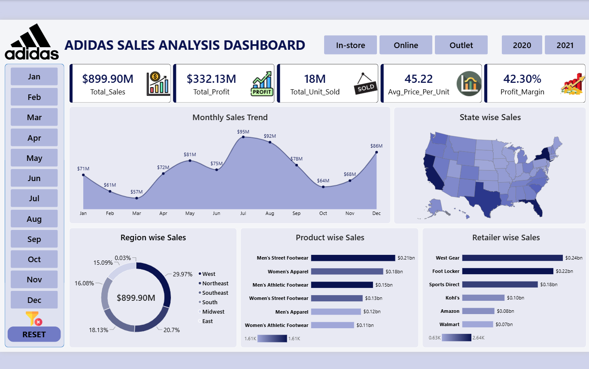

# 👟 Adidas Sales Analysis Dashboard (Power BI)
An interactive Power BI dashboard that helps stakeholders monitor sales performance, understand seasonal trends, and identify top-performing products, retailers, and regions.



## 📌 Business Objective
Enable stakeholders to:
- Monitor overall sales, profit, units sold, average price, and profit margin.
- Analyze monthly sales trends to identify seasonal patterns.
- Compare sales performance across regions and states.
- Evaluate the contribution of retailers and product categories.
- Filter data by sales method, month, and year.
- Identify top-performing products and retailers for strategic planning.

## 📊 Key KPIs
| KPI | Description | Value |
|---|---|---|
| Total Sales | Overall revenue generated | $899.90M |
| Total Profit | Total profit earned from sales | $332.13M |
| Total Units Sold | Number of units sold | 18M |
| Avg. Price per Unit | Average selling price | $45.22 |
| Avg. Profit Margin | Average percentage profit on sales | 42.30% |

## 📈 Visualizations
- **Monthly Sales Trend:** Area chart showing sales across months.
- **State-wise Sales:** Map showing geographic distribution.
- **Region-wise Sales:** Donut chart comparing regional contribution.
- **Product-wise Sales:** Bar chart of top product categories.
- **Retailer-wise Sales:** Bar chart comparing retailer performance.
- **Slicers:** Sales method (In-store, Online, Outlet), Year, and Month.

## 🔍 Key Insights
- Sales peak in **July ($95M)** and are lowest in **March ($57M)**, showing clear seasonality.
- The **West** region contributes the largest share (~30%) of sales.
- **Men's Street Footwear** is the top-selling product category.
- **West Gear** and **Foot Locker** are the leading retailers.
- California, Texas, Florida, and New York are among the strongest states.

## 🛠️ Tools Used
- Power BI Desktop
- DAX (measures and KPIs)
- Power Query (data cleaning and transformation)
- Excel (data source)

## 📁 Project Structure
```
Adidas-Sales-Analysis-Power-BI/
├── Adidas_Sales_Dashboard.pbit   → Power BI template file
├── Adidas_Sales_Data.xlsx        → Dataset
├── dashboard_preview.png         → Dashboard screenshot
└── README.md                     → Project documentation
```

## ▶️ How to Use
1. Clone or download this repository.
2. Open `Adidas_Sales_Dashboard.pbit` in Power BI Desktop.
3. When prompted, point the data.
